<div align="center">


# Hope.Ai

**Jendela dunia belajar untuk pelajar penyandang disabilitas.**

Foto buku lalu dengarkan isinya, tanya tutor AI, belajar bahasa isyarat di depan kamera, dan jelaskan ulang materi dengan suaramu sendiri.
Tampilan, suara, dan cara memakainya menyesuaikan kebutuhan setiap pelajar, bahkan bisa dipakai hanya dengan suara.

[](https://hope-ai-nu.vercel.app)
[](https://api.bennedistus.web.id/health)
[](https://github.com/MuhammadHadistRifannan/Hope-AI/actions/workflows/ci.yml)


Dibuat oleh tim **katanyainivibecodersemua** untuk Web Development Competition **UINIC 8.0** (2026).

</div>

---

## 📚 Daftar isi

1. [Kenalan dulu](#-kenalan-dulu)
2. [Perjalanan seorang pelajar di Hope.Ai](#-perjalanan-seorang-pelajar-di-hopeai)
3. [Fitur](#-fitur)
4. [Bagaimana setiap fitur bekerja](#-bagaimana-setiap-fitur-bekerja)
5. [Arsitektur](#-arsitektur)
6. [Setup di laptop sendiri](#-setup-di-laptop-sendiri)
7. [Kalau ada yang error](#-kalau-ada-yang-error)
8. [Tes dan pengecekan otomatis](#-tes-dan-pengecekan-otomatis)
9. [Isi repositori](#-isi-repositori)
10. [Database](#-database)
11. [Daftar API](#-daftar-api)
12. [Keamanan dan privasi](#-keamanan-dan-privasi)
13. [Deployment](#-deployment)
14. [Cara pakai aplikasinya](#-cara-pakai-aplikasinya)
15. [Kredit](#-kredit)

---

## 👋 Kenalan dulu

Banyak materi belajar masih berbentuk buku cetak dan tampilan yang sama untuk semua orang. Bagi pelajar **tunanetra, low vision, tuli, disleksia, buta warna**, atau yang sulit memakai tangan, itu sudah jadi penghalang sebelum belajarnya dimulai.

Hope.Ai mencoba membuka penghalang itu. Idenya sederhana: **Hope.Ai adalah jendela dunia**. Apa pun cara seseorang melihat, mendengar, membaca, atau bergerak, jendelanya tetap bisa dibuka.

| | |
|---|---|
| 🎯 **Subtema** | Pendidikan |
| 🌍 **SDGs** | Nomor 4 (Pendidikan Berkualitas) dan nomor 10 (Berkurangnya Kesenjangan) |
| 👥 **Pengguna** | Pelajar penyandang disabilitas, guru atau pendamping, dan admin sekolah |
| 🏆 **Kompetisi** | Web Development Competition UINIC 8.0 (2026) |

---

## 🧭 Perjalanan seorang pelajar di Hope.Ai

Begitu masuk pertama kali, Hope.Ai menanyakan **kebutuhan** pelajar (bukan label disabilitasnya). Jawabannya langsung mengubah tampilan, suara, dan fitur yang disarankan.

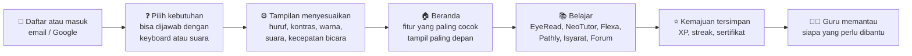

Contoh bagaimana satu jawaban mengubah aplikasi:

| Kebutuhan yang dipilih | Yang langsung berubah | Fitur yang disorot |
|---|---|---|
| 🦯 Lebih mudah mendengar daripada melihat | Materi dibacakan otomatis, Beranda berupa daftar yang mudah dibacakan pembaca layar | EyeRead, NeoTutor, kontrol suara |
| 🔍 Butuh tulisan besar dan kontras | Teks diperbesar, kontras tinggi menyala | Panel aksesibilitas |
| 🎨 Sulit membedakan warna | Merah dan hijau diganti oranye dan biru di seluruh aplikasi | Kenali Warna |
| 🧏 Berkomunikasi dengan isyarat | Semua suara disertai teks, notifikasi berupa kedipan | Isyarat (SIBI dan BISINDO) |
| 📖 Kesulitan membaca teks padat | Huruf ramah disleksia, baris lebih pendek, suara lebih pelan | Flexa versi bahasa sederhana |
| 🧠 Lebih paham dengan penjelasan sederhana | Versi bahasa sederhana jadi tampilan utama | Flexa, NeoTutor |
| ⌨️ Lebih nyaman dengan keyboard | Semua menu bisa dijangkau dengan keyboard dan suara | Kontrol suara |
| ✍️ Lebih nyaman mengetik | Tombol mikrofon disembunyikan, semua bisa diketik | NeoTutor dengan pilihan cepat |

---

## ✨ Fitur

### 📚 Belajar

| | Modul | Buat apa |
|---|---|---|
| 📷 | **EyeRead** | Foto halaman buku atau papan tulis, lalu teksnya dibacakan dan bisa diringkas. **Mode Langsung** membaca otomatis begitu kamera diarahkan, tanpa menekan tombol. Ada juga alat **Kenali Warna** untuk pengguna buta warna. |
| 🤖 | **NeoTutor** | Tutor AI yang bisa diajak ngobrol lewat ketikan atau suara. Bisa membahas satu materi atau dokumen tertentu, dan setiap percakapan tersimpan terpisah. |
| 📖 | **Flexa** | Materi tiga tingkat yang bisa dibaca, didengar, disederhanakan, dan diringkas. Fitur **Jelaskan dengan suaramu**: setelah membaca, pelajar menjelaskan ulang materinya, lalu AI menilai bagian yang sudah dipahami, yang terlewat, dan yang keliru. |
| 🤟 | **Isyarat** | Kamus abjad dan angka **SIBI** serta 43 kata **BISINDO**, lalu latihan langsung di depan kamera. Kamera mengenali isyarat yang diperagakan dan membacakannya. |
| 🗺️ | **Pathly** | Peta belajar berlevel dengan kuis, XP, streak harian, sertifikat PDF, dan dua permainan latihan. Sebuah modul baru dianggap selesai jika semua soalnya dijawab benar. |
| 📝 | **Kuis adaptif** | AI menyusun soal dari materi atau dokumen apa pun. Tingkat soal naik saat jawaban benar dan turun saat salah. |
| 💬 | **EchoForum** | Forum diskusi dengan komentar, suka, dan tombol untuk membacakan postingan. |

### ♿ Aksesibilitas

| | Fitur | Buat apa |
|---|---|---|
| 🎙️ | **Kontrol suara penuh** | Pindah halaman, menekan tombol, menjawab kuis, dan mendengar isi halaman hanya dengan suara. Tekan `Alt+M` atau ketuk tombol mikrofon. |
| 🧰 | **Panel aksesibilitas** | Tombol melayang di setiap halaman berisi 12 alat: perbesar teks, jarak baris, rata kiri, huruf mudah dibaca, kontras tinggi, hitam putih, sembunyikan gambar, hentikan animasi, sorot tautan, masker baca, fokus jelas, dan struktur halaman. |
| 🎨 | **Mode buta warna** | Palet Okabe-Ito: semua warna merah dan hijau di aplikasi diganti oranye dan biru yang mudah dibedakan. |
| 🔊 | **Suara AI** | Materi, hasil pindai, dan jawaban tutor dibacakan dengan suara natural. Jika tidak tersedia, otomatis memakai suara perangkat. |
| 🧑‍🦯 | **Ramah pembaca layar** | Struktur judul yang benar, label untuk setiap tombol, pengumuman perubahan, dan tautan "Lompat ke konten utama". Lolos audit WCAG 2.1 AA (axe) di semua halaman utama. |

### 👩‍🏫 Guru dan admin

| | Fitur | Buat apa |
|---|---|---|
| 🏫 | **Ruang Guru** | Menambah materi, melihat kemajuan setiap siswa (level, nilai kuis, pemahaman lisan, bagian yang sering terlewat), dan daftar siswa yang perlu perhatian. |
| 🛡️ | **Admin** | Statistik pemakaian, daftar pengguna, pengelolaan modul, dan moderasi forum. |

<div align="center">

<br/><sub>Hope.Ai bisa dipakai hanya dengan suara</sub>
</div>

---

## 🔬 Bagaimana setiap fitur bekerja

### 📷 EyeRead: dari halaman buku menjadi suara

Mode biasa memotret satu halaman. **Mode Langsung** terus memeriksa kamera, dan baru mengirim foto ke server saat ada halaman baru yang benar-benar layak dibaca. Pemeriksaan awalnya dikerjakan di perangkat, jadi hemat kuota dan cepat.

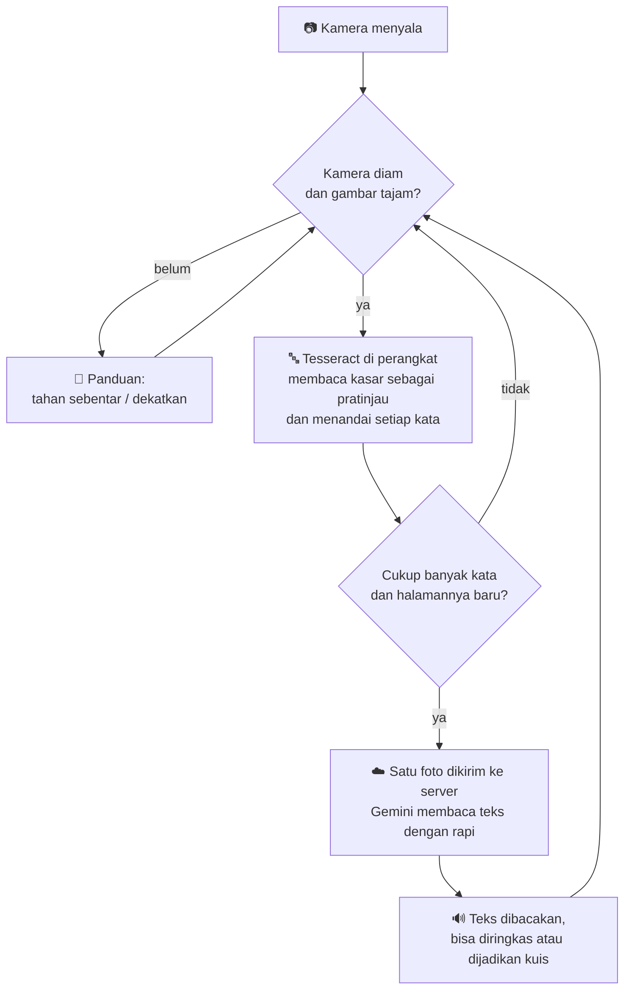

### 🗣️ Flexa: "Jelaskan dengan suaramu"

Teknik Feynman untuk pelajar yang tidak bisa atau sulit menulis: belajar dengan menjelaskan ulang. Bisa dimulai tanpa menyentuh layar dengan perintah suara **"jelaskan materi ini"**, lalu ditutup dengan kata **"selesai"**.

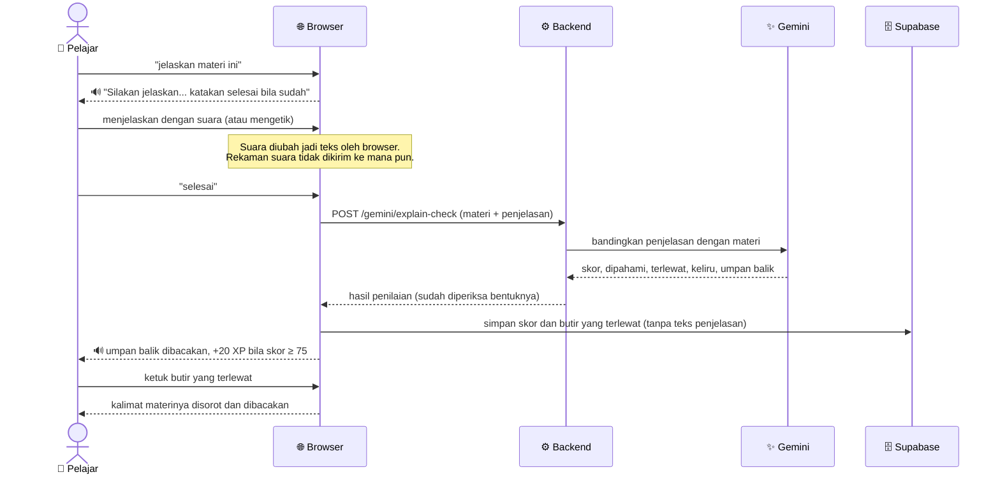

### 🤟 Isyarat: kamera mengenali bahasa isyarat

Semua pengenalan berjalan **di dalam browser**. Gambar kamera tidak pernah dikirim ke server.

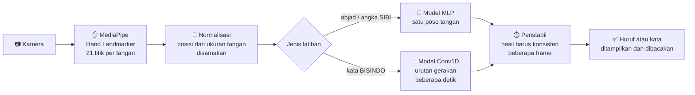

<div align="center">
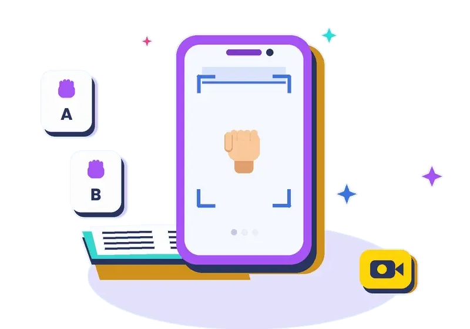
</div>

Akurasi model, dilaporkan apa adanya:

| Model | Isi | Cara diuji | Hasil |
|---|---|---|---|
| SIBI abjad | Huruf A–Z | Data uji terpisah | Dipakai untuk latihan utama |
| SIBI angka | Angka 1–9 | Data dari Kamus SIBI | Masih **Beta** |
| BISINDO kata | 43 kata sehari-hari | **Signer-independent**: diuji pada orang yang tidak ikut data latih | **81,1%** rata-rata (0,53–0,95 per orang) |

Model BISINDO dilatih ulang dengan notebook [`ml/bisindo/bisindo_wl_training.ipynb`](ml/bisindo/bisindo_wl_training.ipynb) dari dataset WL-BISINDO dan BISINDO 40 Kata.

### 🎙️ Kontrol suara: memakai aplikasi tanpa menyentuh layar

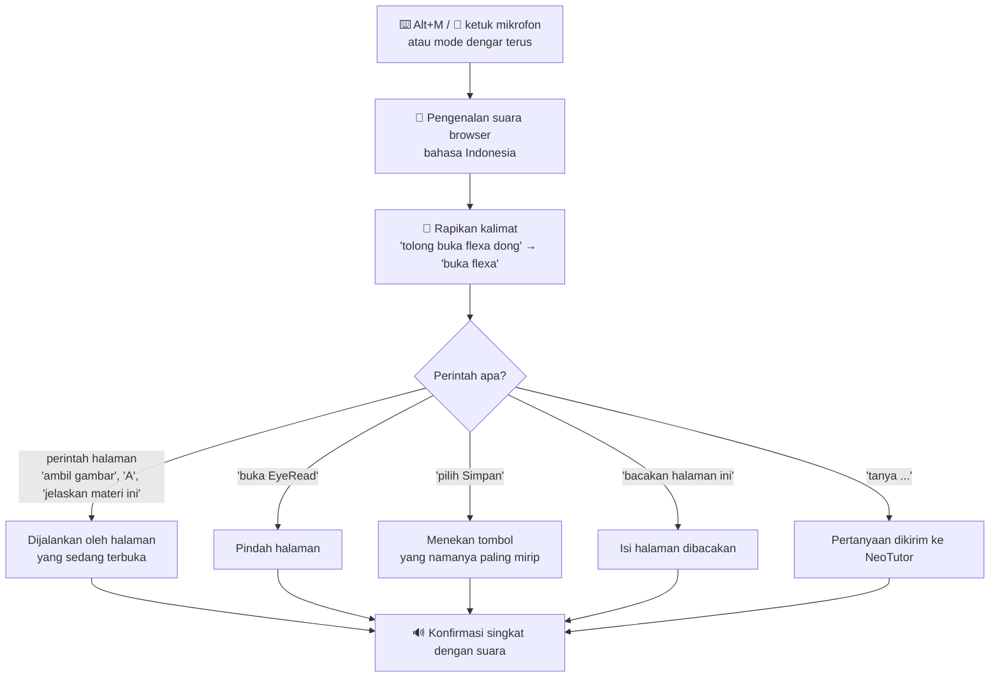

### 🎨 Kenali Warna

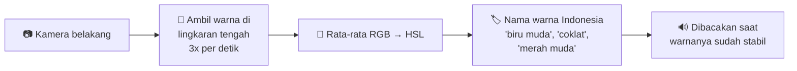

Semua dihitung di perangkat, tanpa AI dan tanpa server.

---

## 🧩 Arsitektur

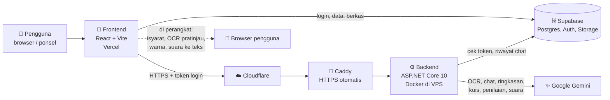

Prinsipnya:

- **Frontend** berbicara langsung dengan **Supabase** untuk login dan data.
- Semua yang butuh AI lewat **backend** dulu. Kunci API Gemini hanya ada di server, tidak pernah sampai ke browser.
- Backend selalu memverifikasi token login sebelum mengerjakan apa pun.
- Pekerjaan yang bisa dikerjakan di perangkat **tetap di perangkat**: ini lebih cepat, hemat kuota, dan menjaga privasi.

| Diproses di mana | Pekerjaan |
|---|---|
| 📱 **Perangkat pengguna** | Pengenalan isyarat (MediaPipe), pratinjau OCR Mode Langsung (Tesseract.js), Kenali Warna, pengenalan suara untuk perintah, pengaturan aksesibilitas |
| ⚙️ **Backend + Gemini** | OCR akhir, chat NeoTutor, ringkasan, bahasa sederhana, kuis, penilaian "Jelaskan", suara AI |
| 🗄️ **Supabase** | Akun, kemajuan belajar, materi, forum, notifikasi |

| Bagian | Teknologi |
|---|---|
| Frontend | React 18, TypeScript, Vite, Tailwind CSS, shadcn/ui, Framer Motion |
| Backend | ASP.NET Core 10 (C#) |
| Database | Supabase (PostgreSQL) dengan Row Level Security |
| AI | Google Gemini 2.5 Flash (OCR, chat, ringkasan, kuis, penilaian) dan Gemini TTS (suara) |
| Di perangkat | MediaPipe Hand Landmarker, Tesseract.js, Web Speech API |
| Infrastruktur | Vercel, VPS + Docker Compose + Caddy, Cloudflare, GitHub Actions |

---

## 🚀 Setup di laptop sendiri

Ada dua cara. **Cara A** paling cepat kalau Docker sudah terpasang. **Cara B** kalau ingin menjalankan langsung tanpa Docker.

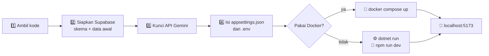

### 🧰 Yang perlu disiapkan

| Alat | Versi | Cek sudah terpasang atau belum |
|---|---|---|
| [Git](https://git-scm.com) | bebas | `git --version` |
| [Docker](https://docs.docker.com/get-docker/) (cara A) | 24 ke atas | `docker --version` |
| [Node.js](https://nodejs.org) (cara B) | 20 ke atas | `node -v` |
| [.NET SDK](https://dotnet.microsoft.com/download) (cara B) | 10 | `dotnet --version` |

Selain itu butuh dua akun gratis:

- 🟢 **[Supabase](https://supabase.com)** untuk database dan login.
- 🔑 **[Google AI Studio](https://aistudio.google.com/apikey)** untuk kunci API Gemini.

### 1️⃣ Ambil kodenya

```bash
git clone https://github.com/MuhammadHadistRifannan/Hope-AI.git
cd Hope-AI
```

### 2️⃣ Siapkan database di Supabase

1. Buka [supabase.com](https://supabase.com), buat **project baru**, lalu tunggu sampai selesai dibuat.
2. Masuk ke menu **SQL Editor**.
3. Jalankan berkas di [`Frontend/supabase/migrations/`](Frontend/supabase/migrations) **satu per satu sesuai urutan nama berkasnya** (salin isi berkas, tempel di SQL Editor, klik **Run**). Ini membuat semua tabel dan aturan aksesnya.
4. Jalankan [`Frontend/supabase/seed.sql`](Frontend/supabase/seed.sql) dengan cara yang sama. Ini mengisi data awal: modul, soal, materi, dan kamus isyarat.
5. Buka **Project Settings → API Keys**, lalu catat:
   - **Project URL**, contohnya `https://abcdefgh.supabase.co`
   - **Publishable key**, yang diawali `sb_publishable_`

> 💡 **Biar gampang saat mencoba:** Supabase mewajibkan konfirmasi email saat daftar. Kalau mau langsung bisa masuk, matikan di **Authentication → Sign In / Providers → Email → Confirm email**.

### 3️⃣ Ambil kunci API Gemini

Buka [Google AI Studio](https://aistudio.google.com/apikey), klik **Create API key**, lalu salin kuncinya.

> ⚠️ Kunci ini rahasia. Jangan ditaruh di frontend, jangan di-commit, dan jangan dibagikan.

### 4️⃣ Isi konfigurasi

**Backend**: salin contoh konfigurasinya.

```bash
cp BE/appsettings.example.json BE/appsettings.json
```

Buka `BE/appsettings.json` lalu isi:

```json
{
  "APIKEY": "kunci-gemini-kamu",
  "Supabase": {
    "Url": "https://abcdefgh.supabase.co",
    "PublishableKey": "sb_publishable_xxx"
  },
  "Cors": {
    "AllowedOrigins": ["http://localhost:5173"]
  }
}
```

**Frontend**: salin contoh `.env`.

```bash
cp Frontend/.env.example Frontend/.env
```

Buka `Frontend/.env` lalu isi:

```env
VITE_SUPABASE_PROJECT_ID="abcdefgh"
VITE_SUPABASE_URL="https://abcdefgh.supabase.co"
VITE_SUPABASE_PUBLISHABLE_KEY="sb_publishable_xxx"
VITE_API_URL="http://localhost:5114"
```

`VITE_SUPABASE_PROJECT_ID` adalah bagian depan URL project kamu (sebelum `.supabase.co`).

> 🔐 **Login Google (opsional):** aktifkan provider Google di **Supabase → Authentication → Sign In / Providers**, tambahkan `https://<project>.supabase.co/auth/v1/callback` sebagai Authorized redirect URI di Google Cloud, lalu isi `VITE_AUTH_PROVIDERS="google"`. Kosongkan untuk menyembunyikan tombol login sosial.

### 5️⃣ Jalankan

**Cara A, dengan Docker** (backend dan frontend sekaligus):

```bash
docker compose -f docker-compose.local.yml up -d
```

**Cara B, tanpa Docker** (dua terminal):

```bash
# Terminal 1: backend
cd BE
dotnet run --launch-profile http
```

```bash
# Terminal 2: frontend
cd Frontend
npm install
npm run dev
```

Lalu cek:

- ⚙️ Backend: buka http://localhost:5114/health. Kalau muncul `{"status":"ok"}`, berarti aman. ✅
- 🎨 Frontend: buka **http://localhost:5173**. 🎉

### 6️⃣ Daftar akun dan coba

1. Klik **Daftar**, isi nama, email, dan kata sandi (atau masuk dengan Google).
2. Konfirmasi lewat email, kecuali tadi sudah dimatikan.
3. Masuk. Akan muncul pertanyaan tentang kebutuhan belajar; jawab atau lewati.
4. Coba EyeRead dengan foto teks, ucapkan "buka NeoTutor", atau buka menu Isyarat.

### 7️⃣ (Opsional) Jadikan akunmu guru atau admin

Supaya menu **Ruang Guru** atau **Admin** muncul, jalankan ini di SQL Editor Supabase (ganti email dan perannya):

```sql
insert into public.user_roles (user_id, role)
select id, 'admin' from auth.users where email = 'email-kamu@contoh.com';
-- peran yang tersedia: 'student', 'teacher', 'admin'
```

Lalu muat ulang aplikasinya.

---

## 🩹 Kalau ada yang error

| Gejalanya | Kemungkinan penyebab | Solusinya |
|---|---|---|
| Fitur AI bilang "terjadi kesalahan", di console browser ada tulisan **CORS** | Alamat frontend belum diizinkan backend | Pastikan `Cors:AllowedOrigins` di `appsettings.json` berisi `http://localhost:5173` persis, lalu jalankan ulang backend |
| Backend membalas **401** | Belum masuk, atau frontend dan backend memakai project Supabase yang berbeda | Masuk dulu. URL Supabase di `.env` dan `appsettings.json` harus sama |
| Backend membalas **502** dengan pesan *API key not valid* | Kunci Gemini salah atau sudah dicabut | Buat kunci baru di AI Studio, ganti `APIKEY`, jalankan ulang backend |
| Sudah daftar tapi tidak bisa masuk | Email belum dikonfirmasi | Cek kotak masuk dan folder spam, atau matikan konfirmasi email (langkah 2) |
| Halaman Pathly, Flexa, atau kamus isyarat kosong | `seed.sql` belum dijalankan | Jalankan `seed.sql` di SQL Editor |
| Error *relation "…" does not exist* | Berkas migrasi belum dijalankan semua | Jalankan semua berkas di `supabase/migrations/` sesuai urutan |
| `dotnet run` meminta framework yang tidak ada | Versi .NET bukan 10 | Pasang .NET SDK 10, atau pakai cara A (Docker) |
| Kamera tidak menyala | Izin kamera ditolak, atau dibuka bukan dari `localhost` / HTTPS | Izinkan kamera di browser. Kamera hanya bisa dipakai di `localhost` atau situs HTTPS |
| Perintah suara tidak jalan | Browser belum mendukung, atau bukan HTTPS | Pakai Chrome, Edge, atau Safari di `localhost` / HTTPS. Perintah tetap bisa diketik |
| Login Google menampilkan *redirect_uri_mismatch* | Callback Supabase belum didaftarkan di Google Cloud | Tambahkan `https://<project>.supabase.co/auth/v1/callback` di Authorized redirect URIs |

---

## 🧪 Tes dan pengecekan otomatis

```bash
cd Frontend
npm test            # 81 tes unit (vitest)
npm run typecheck   # pemeriksaan tipe TypeScript
npm run build       # build produksi
```

Tes unit fokus pada logika yang paling berisiko salah, misalnya pengenalan perintah suara, pencocokan butir "Jelaskan" ke kalimat materi, nama warna, deteksi ketajaman kamera, penstabil isyarat, dan pergantian kutipan harian.

Setiap push dan pull request diperiksa otomatis oleh [GitHub Actions](.github/workflows/ci.yml):

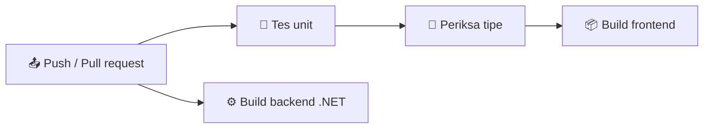

---

## 📁 Isi repositori

```
Hope-AI/
├── Frontend/                     🎨 Aplikasi web (React)
│   ├── src/pages/                Satu berkas per halaman: Landing, Beranda, EyeRead, NeoTutor,
│   │                             Flexa, Pathly, Isyarat, Forum, Ruang Guru, Admin, ...
│   ├── src/components/           Komponen bersama: panel aksesibilitas, asisten suara,
│   │                             Kenali Warna, Jelaskan, kamus isyarat; ui/ berisi shadcn/ui
│   ├── src/components/landing/   Hero "Jendela Dunia" yang digerakkan scroll
│   ├── src/context/              Pengaturan aksesibilitas global
│   ├── src/hooks/                Hook kamera, Mode Langsung, peran pengguna
│   ├── src/lib/                  Logika murni beserta tesnya (*.test.ts)
│   ├── src/integrations/         Klien dan tipe Supabase
│   ├── public/                   Model isyarat, video BISINDO, animasi, font
│   └── supabase/                 Skema database (migrations/) dan data awal (seed.sql)
├── BE/                           ⚙️ Backend (ASP.NET Core)
│   ├── Controllers/              Endpoint HTTP
│   ├── Services/                 Gemini, OCR, suara, riwayat chat, penilaian "Jelaskan"
│   ├── Interfaces/               Kontrak service
│   └── Dockerfile
├── ml/                           🧠 Notebook dan skrip pelatihan model isyarat
├── models/                       Hasil pelatihan model dan data uji
├── deploy/                       🐳 Docker Compose dan Caddy untuk VPS
├── user-testing/                 📋 Kuesioner UEQ untuk uji pengguna
├── docs/                         📄 Rencana kerja dan guidebook lomba
├── scrollcraft/                  Catatan desain hero landing
├── docker-compose.local.yml      Menjalankan semuanya di laptop
└── .github/workflows/            🔁 Tes otomatis dan deploy backend
```

---

## 🗄️ Database

Ada **19 tabel**, semuanya dijaga Row Level Security.

| Kelompok | Tabel |
|---|---|
| 👤 Akun | `profiles`, `user_roles`, `user_settings` |
| 🗺️ Pathly | `learning_modules`, `quiz_questions`, `module_progress`, `quiz_attempts`, `game_scores` |
| 📖 Flexa dan EyeRead | `materials`, `sign_items`, `user_documents`, `document_quiz_attempts`, `explain_attempts` |
| 🤖 NeoTutor | `chat_sessions`, `chat_messages` |
| 💬 Forum | `forum_posts`, `forum_comments`, `forum_post_likes` |
| 🔔 Lainnya | `notifications` |

Hal-hal yang terjadi otomatis di database:

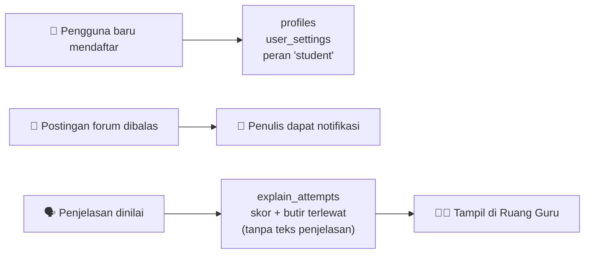

---

## 🔌 Daftar API

Semua endpoint, kecuali `/health` dan `/docs`, butuh header `Authorization: Bearer <token login Supabase>`.

Dokumentasi interaktifnya ada di **[api.bennedistus.web.id/docs](https://api.bennedistus.web.id/docs)**, atau `http://localhost:5114/docs` saat jalan di lokal.

| Metode dan jalur | Kirim apa | Dapat apa |
|---|---|---|
| `GET /health` | - | `{ "status": "ok" }` |
| `POST /gemini/chat` | JSON `{ "text", "sessionId"? }` | `{ "status", "response", "sessionId" }` |
| `POST /gemini/summary` | JSON `{ "text" }` | `{ "message" }` |
| `POST /gemini/simplify` | JSON `{ "text" }` | `{ "message", "truncated" }`, versi bahasa sederhana |
| `POST /gemini/quiz` | JSON `{ "text" }` | `{ "questions": [{ "q", "options", "a", "difficulty" }] }` |
| `POST /gemini/explain-check` | JSON `{ "material", "explanation" }` (penjelasan 20–3.000 karakter) | `{ "skor", "dipahami", "terlewat", "keliru", "umpan_balik" }` |
| `POST /gemini/tts` | JSON `{ "text" }` (maks. 1.200 karakter) | audio WAV |
| `POST /scan/ocr` | form-data `image` (PNG, JPG, WEBP) | teks polos |
| `POST /scan/extract` | form-data `file` (PDF, PNG, JPG, TXT) | `{ "text" }` |

Arti kode status:

| Kode | Artinya |
|---|---|
| `400` | Masukan tidak valid (misalnya teks kosong atau terlalu panjang) |
| `401` | Belum masuk atau token tidak sah |
| `404` | Sesi chat tidak ditemukan atau bukan milikmu |
| `413` | Berkas lebih dari 10 MB |
| `415` | Jenis berkas tidak didukung |
| `429` | Terlalu banyak permintaan (batas 30 per menit per pengguna), atau kuota suara AI sedang habis |
| `502` / `503` | Layanan AI sedang bermasalah |

---

## 🔒 Keamanan dan privasi

- 🪪 **Login dicek sungguhan.** Backend memverifikasi tanda tangan token Supabase lewat JWKS, termasuk penerbit dan audiensnya.
- 🧱 **Data dijaga di database.** Row Level Security di setiap tabel: pengguna hanya bisa membaca dan mengubah datanya sendiri, guru hanya bisa melihat kemajuan siswa, dan yang belum masuk tidak bisa mengakses apa pun.
- 👮 **Peran tidak bisa diubah sendiri.** Peran disimpan di tabel terpisah dan dicek oleh fungsi yang tidak terbuka lewat API.
- 🗂️ **Percakapan tidak bisa tercampur.** Backend tidak menyimpan riwayat chat di memori. Riwayat dibaca dari database dengan token milik pengguna itu sendiri.
- ✅ **Masukan dan jawaban AI divalidasi.** Ada batas panjang teks, batas ukuran berkas, daftar jenis berkas yang diizinkan, dan jawaban AI diperiksa bentuknya sebelum ditampilkan.
- 📱 **Gambar kamera untuk isyarat dan warna tidak pernah keluar dari perangkat.** Rekaman suara juga tidak disimpan; yang diterima hanya teks hasilnya.
- 🙋 **Data kebutuhan hanya disimpan di akun jika pengguna setuju.** Tanpa persetujuan, disimpan di perangkat saja.
- 🚧 **Pembatas lain:** CORS hanya untuk alamat frontend, rate limiting per pengguna, dan HTTPS di seluruh jalur.
- 🤫 **Rahasia tetap rahasia.** Kunci Gemini hanya ada di variabel lingkungan server, tidak ada di repositori maupun di kode yang diunduh browser.

Rincian lengkap untuk pengguna ada di halaman **Privasi** dan **Aksesibilitas** di dalam aplikasi.

---

## 🚢 Deployment

| Bagian | Di mana | Cara update |
|---|---|---|
| 🎨 Frontend | Vercel | Otomatis setiap push ke `main` |
| ⚙️ Backend | VPS (Docker Compose + Caddy) | Otomatis lewat [GitHub Actions](.github/workflows/backend.yml) saat `BE/` atau `deploy/` berubah |
| 🗄️ Database | Supabase | Jalankan berkas migrasi baru di SQL Editor |

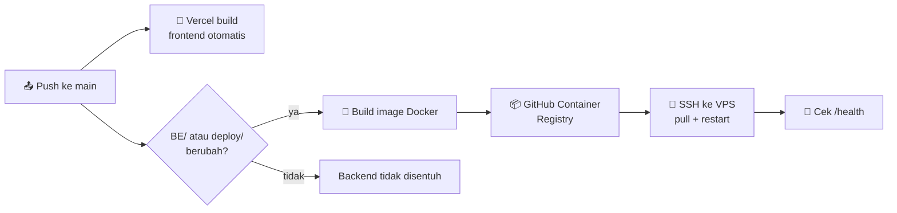

Sertifikat HTTPS diurus Caddy secara otomatis. Konfigurasi server ada di `/opt/hopeai/.env`, dengan contoh isi di [`deploy/.env.example`](deploy/.env.example).

---

## 🎓 Cara pakai aplikasinya

1. 📝 **Daftar dan masuk** dengan email atau Google.
2. ♿ **Pilih kebutuhanmu** di pertanyaan pertama. Bisa diubah kapan saja di **Pengaturan**, atau lewat **panel aksesibilitas** (tombol bulat biru di kanan bawah).
3. 🎙️ **Pakai suara**: tekan `Alt+M` atau ketuk tombol mikrofon, lalu ucapkan misalnya "buka EyeRead", "bacakan halaman ini", atau "bantuan".
4. 📷 **Baca buku cetak**: buka EyeRead, arahkan kamera atau unggah foto. Nyalakan **Mode Langsung** supaya halaman dibacakan otomatis. Pilih **Kenali Warna** untuk menanyakan warna benda.
5. 🤖 **Tanya tutor**: buka NeoTutor, ketik atau ucapkan pertanyaan. Pakai "Percakapan Baru" untuk topik lain.
6. 📖 **Belajar dari materi**: buka Flexa, pilih tingkat dan bab. Setelah membaca, buka tab **Jelaskan** (atau ucapkan "jelaskan materi ini") untuk menguji pemahamanmu.
7. 🤟 **Belajar isyarat**: buka **Isyarat**, pilih SIBI atau BISINDO, lihat kamusnya, lalu latihan di depan kamera.
8. 🗺️ **Latihan**: buka Pathly dan selesaikan level satu per satu. Sertifikat bisa diunduh setelah semua level tuntas.
9. 💬 **Diskusi**: buka EchoForum untuk bertanya atau membantu teman.

⌨️ **Tanpa mouse:** tekan `Tab` untuk berpindah antar tombol dan `Enter` untuk memilih. Tautan "Lompat ke konten utama" muncul saat `Tab` ditekan pertama kali di setiap halaman.

---

## 🙏 Kredit

- **Dataset isyarat:** WL-BISINDO (CC BY-NC 4.0), BISINDO 40 Kata (MIT), dan Kamus SIBI. Video contoh BISINDO beserta lisensinya ada di [`Frontend/public/sign/bisindo/LICENSE.txt`](Frontend/public/sign/bisindo/LICENSE.txt).
- **Model dan pustaka:** MediaPipe (Google), Tesseract.js, Google Gemini.
- **Kutipan harian** di landing berasal dari tokoh dunia dengan sumber yang bisa ditelusuri: Helen Keller, Nelson Mandela, Malala Yousafzai, Stephen Hawking, Temple Grandin, dan Ki Hajar Dewantara.

Daftar lengkapnya ada di halaman **Kredit** di dalam aplikasi.

---

<div align="center">

Dibuat dengan 💜 oleh **katanyainivibecodersemua** untuk pendidikan yang bisa diakses semua orang.

</div>
